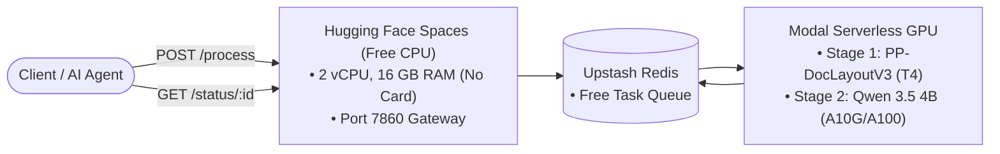

# 📄 Production OCR Platform

> A production-grade, self-scaling Visual Document Understanding (VDU) & OCR pipeline built for 100% cloud deployment with zero credit card requirements.

---

## 🌟 Overview

The **Production OCR Platform** combines deterministic layout analysis with generative Small Language Models (SLMs) to accurately transcribe text, convert tables into Markdown, format mathematical formulas into LaTeX, and describe charts and diagrams.



---

## 🏗️ Architecture

- **Ingestion Gateway (`gateway/`)**: FastAPI application providing file validation, base64 payload packaging, and task management. Configured for Hugging Face Spaces (port `7860`).
- **Asynchronous Worker (`worker/`)**: Dynamic batching collector (`100ms` window, `max 4` batch) with zero-copy shared memory (`/dev/shm`) buffer transfer.
- **Serverless GPU Inference (`inference/`)**: Modal application coordinating `PP-DocLayoutV3` on T4 GPUs and `Qwen 3.5 4B` on A10G/A100 GPUs with scale-to-zero economics.
- **Agent Tooling (`mcp/`)**: FastMCP server enabling AI assistants (Claude Code, Antigravity) to invoke document parsing natively.

---

## 🚀 Quickstart

### 1. Run Unit Tests
```bash
make test
```

### 2. Local Execution (Docker Compose)
```bash
make up
```

The gateway will be available at `http://localhost:7860`.

### 3. Deploy Serverless GPU Layer to Modal
```bash
modal setup
make deploy-modal
```

### 4. Deploy Gateway to Hugging Face Spaces
See the step-by-step instructions in [`deploy/hf_spaces/README.md`](deploy/hf_spaces/README.md).

---

## 📜 API Endpoints

- `POST /process`: Upload PDF or image (max 10MB) via multipart form field `file`. Returns `202 Accepted` with `task_id`.
- `GET /status/{task_id}`: Poll task progress. When complete, returns structured Markdown and layout regions.
- `GET /health`: Health probe.

---

## 📄 License
This project is licensed under the MIT License.
